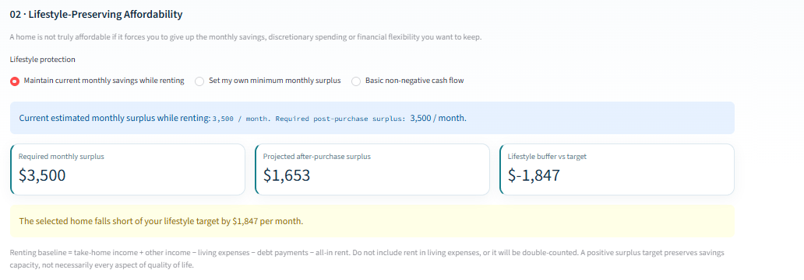
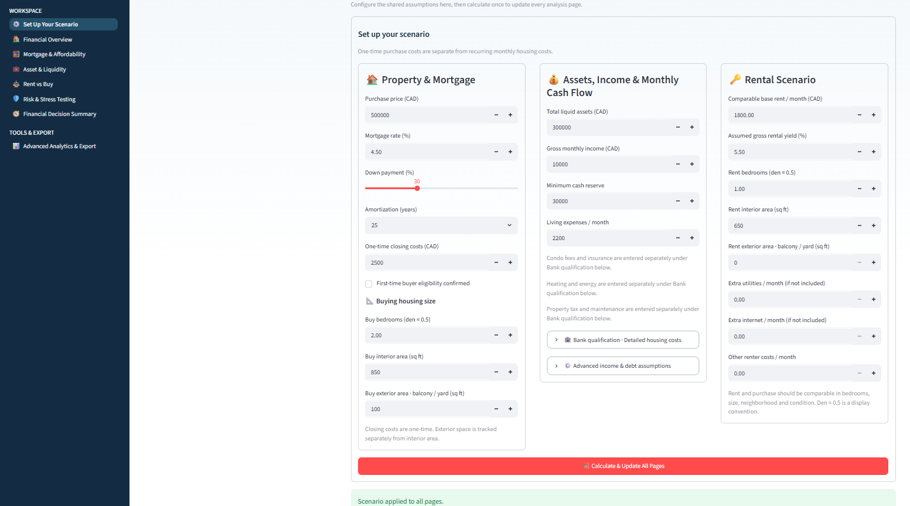
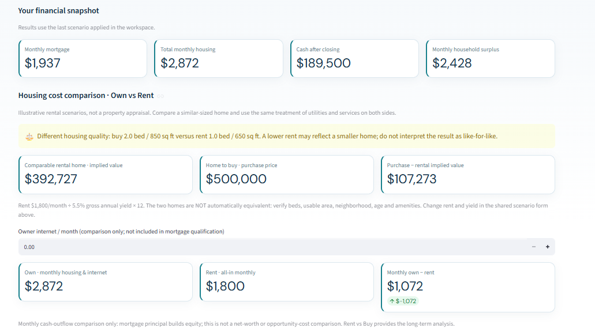
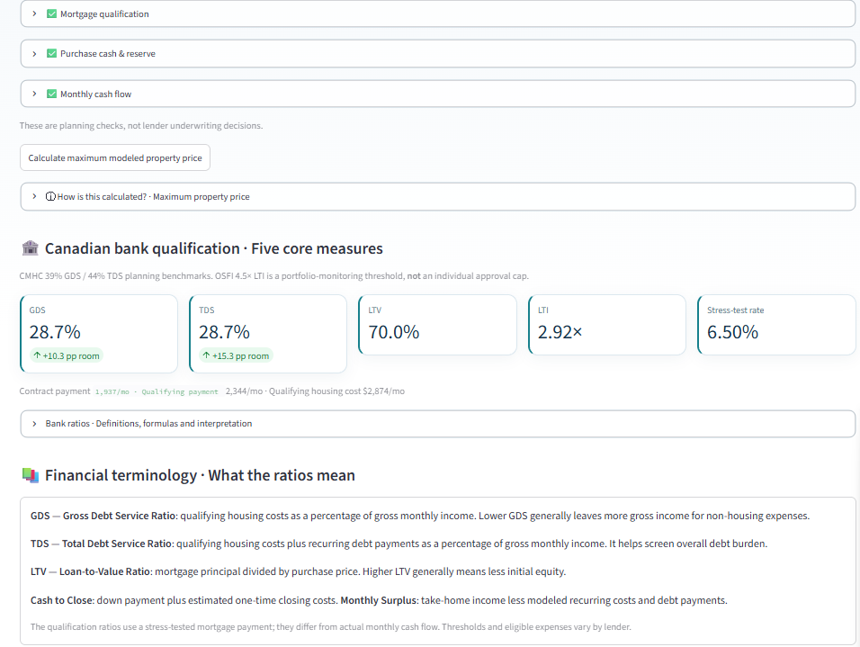
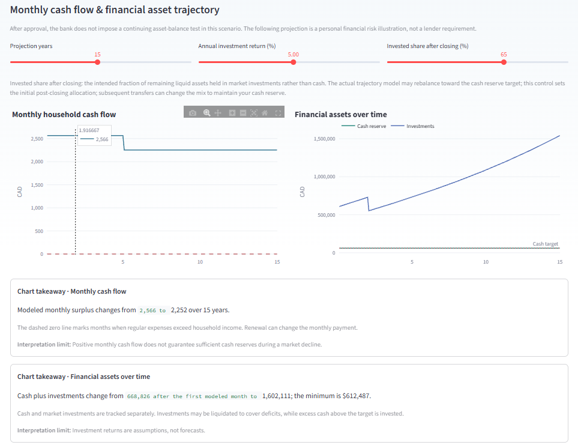
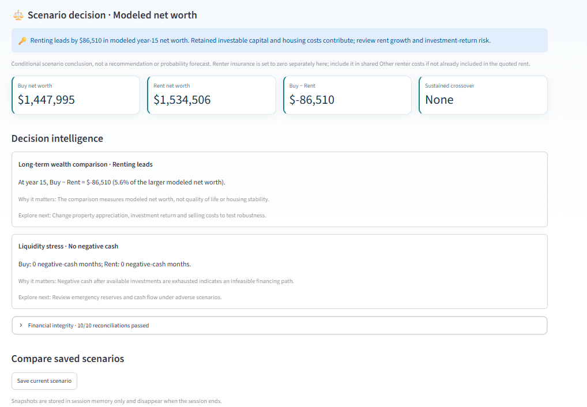
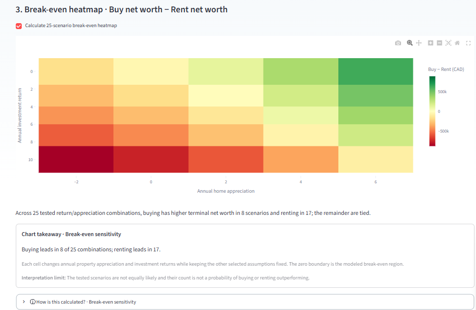
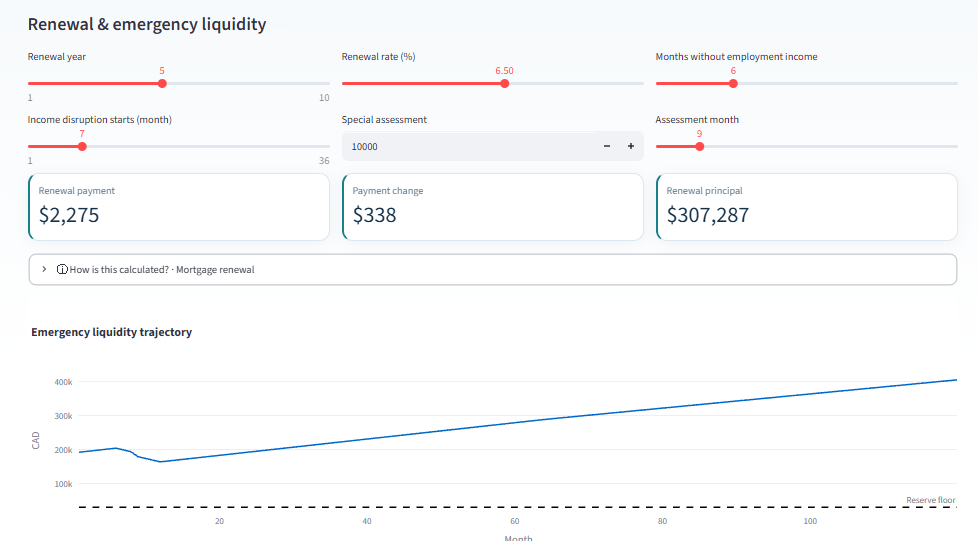
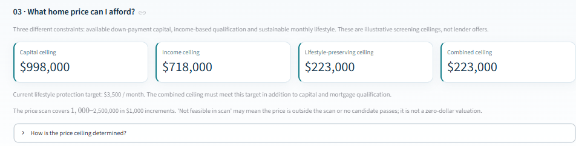
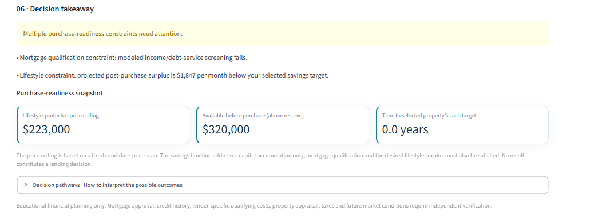

# Mortgage Financial Planner

**An interactive financial decision-support platform for evaluating mortgage qualification, housing affordability, rent-versus-buy outcomes, and financial resilience in British Columbia, Canada.**




**Python · Streamlit · Pandas · Plotly · OpenPyXL · Financial Modeling · Scenario Analysis**  
**Version:** v2.4.2 · Portfolio prototype  
**Currency:** CAD · **Geographic scope:** British Columbia, Canada

> **Project status:** Tested prototype. Educational decision-support and sensitivity analysis, not mortgage pre-approval, financial advice, a real estate appraisal, or a forecast. Model assumptions must be independently verified before any real-world decision.

## 1. Executive overview

Mortgage approval and sustainable homeownership are different questions. A household may meet lender-style debt-service thresholds yet experience a substantial reduction in monthly savings, financial flexibility, or liquidity after buying a home. This project translates that gap into an interactive financial decision workflow.

The application evaluates **four constraints independently**: (1) purchase capital, (2) income-based mortgage qualification, (3) post-purchase cash flow, and (4) a user-defined lifestyle-preservation target. It then explores purchase timing, rent-versus-buy net worth, market sensitivity, and downside risk.

**Primary contribution — Lifestyle-Preserving Affordability:** Rather than defining affordability as nonnegative cash flow alone, users can require their post-purchase monthly surplus to match their estimated savings while renting, or select a custom savings target. The model recalculates the feasible home-price ceiling under that requirement.

## 2. Research questions

1. Does a proposed mortgage satisfy modeled Canadian debt-service qualification checks?
2. How much home can a household afford based on **capital**, **income**, and **desired monthly savings**, separately and jointly?
3. How do ownership costs, rental costs, liquidity, and projected net worth differ?
4. How long might it take to accumulate sufficient purchase capital under changing assumptions?
5. How resilient is the decision to mortgage renewal, job disruption, market drawdowns, and unexpected property expenses?

### Navigation map

The eight application pages are **Set Up Your Scenario**, **Financial Overview**, **Mortgage & Affordability**, **Asset & Liquidity**, **Rent vs Buy**, **Risk & Stress Testing**, **Financial Decision Summary**, and **Advanced Analytics & Export**.

## 3. Application walkthrough

### Step 1 — Configure a shared financial scenario



Enter purchase price, mortgage terms, down payment, cash and investments, gross and estimated net income, debt obligations, housing costs, minimum reserve, rental assumptions, and dwelling characteristics. Click **Calculate & Update All Pages** to apply the scenario across the application. Scenario inputs are shared within the current Streamlit session; they are **not permanently stored**.

### Step 2 — Compare the current financial picture



The Financial Overview displays mortgage payment, total ownership outflow, post-closing liquidity, household surplus, and comparable rental costs. Donut charts and direct bars decompose the monthly expenses; a separate capital-allocation chart explains how the down payment and closing costs affect liquid assets. **Monthly cash outflow is not equivalent to economic cost or net worth** because mortgage principal repayment builds equity.

### Step 3 — Examine mortgage qualification



The qualification workspace reports stress-tested **GDS**, **TDS**, **LTV**, **LTI**, and mortgage stress-test rate, alongside cash-to-close and monthly cash flow. It distinguishes the qualifying payment from the actual contractual mortgage payment. The 39% GDS / 44% TDS figures are planning benchmarks, **not universal lender approval rules**.

### Step 4 — Evaluate assets and long-term liquidity



An illustrative asset-supported financing scenario examines eligible investment assets, down-payment capital, financing headroom, cash reserves, and investment growth. Cash and investments are modeled separately, with diagnostic measures for reserve shortfalls and investment withdrawals. **Asset-supported financing is hypothetical**, not an advertised lender product or commitment.

### Step 5 — Compare renting and buying



The Rent vs Buy model compares projected terminal net worth, home equity, investable assets, and liquidity across two financial pathways. Its break-even heatmap varies home appreciation and investment returns. It also flags when the rental and purchase properties differ in size or other quality proxies, to avoid treating unequal housing options as equivalent.



### Step 6 — Stress-test the plan



Test mortgage renewal rates, employment-income disruption, special assessments, property price declines, income reductions, investment drawdowns, and combined adverse scenarios. Sensitivity charts distinguish cash-flow outcomes from underwriting qualification. The tested scenarios are **not probability-weighted forecasts**.

### Step 7 — Make a lifestyle-preserving decision



The consolidated Financial Decision Summary brings together qualification, monthly savings preservation, four home-price ceilings, down-payment accumulation, dynamic purchase readiness, five-year cash flow, and a final conditional takeaway.

### Decision takeaway — six conditional outcomes

The final summary does not automatically recommend purchasing. It interprets the selected property through a conditional decision tree:

| Outcome | Interpretation | Potential next action |
|---|---|---|
| All checks pass | Capital, income screening, monthly cash flow and protected savings target pass | Compare rent-versus-buy net worth and downside scenarios |
| Lifestyle shortfall | Baseline checks may pass, but buying reduces savings below the chosen target | Lower the purchase price or reassess the savings target |
| Capital shortfall | Insufficient funds for purchase costs and required reserve | Save longer, reduce price or change capital allocation |
| Mortgage qualification shortfall | Income/debt-service screening fails | Reduce borrowing/debt or increase qualifying income |
| Negative monthly cash flow | Ownership expenses exceed modeled available monthly income | Rework the budget before buying |
| Multiple constraints | Several tests fail simultaneously | Address all binding constraints, not just one |




**Illustrative screenshot note:** Images may show different hypothetical scenarios. The lifestyle screenshot shows a CAD 1,847 monthly gap, while other screenshots may show earlier inputs. They are not a single reconciled financial case.

## 4. Inputs and variables

| Category | Modeled inputs |
|---|---|
| Property and financing | Purchase price, down payment %, contract mortgage rate, amortization years, one-time closing costs, first-time-buyer eligibility |
| Income and capital | Gross monthly income, estimated net income fraction, other monthly income, total liquid assets, minimum cash reserve |
| Household commitments | Living expenses, monthly debt payments |
| Ownership costs | Strata/condo fees, condo insurance, property tax, maintenance, heating/energy; owner internet for comparison |
| Rental comparison | Base monthly rent, assumed gross rental yield, renter utilities, internet and other costs |
| Housing comparability | Buying and renting bedrooms (den = 0.5), interior square footage, exterior square footage |
| Asset planning | Investment recognition %, eligible asset-to-loan ratio, down payment %, drawdown stress, projected returns, invested share, reserve target |
| Rent-vs-buy assumptions | Analysis horizon, property appreciation, rent growth, investment return, selling costs, financing pathway |
| Downside scenarios | Mortgage renewal year/rate, income-disruption timing and duration, special assessment, price decline, income reduction, asset drawdown |
| Purchase readiness | Savings horizon, savings growth, home-price growth, income growth, rent growth, living-cost growth, asset return, lifestyle surplus target |

**Important:** Some variables are page-specific sensitivity controls rather than globally applied scenario inputs. Net income is an assumption, **not** an implemented tax calculator. Costs for different home prices may need manual adjustment.

## 5. Financial methodology

### Mortgage payment and qualification

For mortgage principal $P$, periodic interest rate $r$, and number of monthly payments $n$:

$$
M = \frac{P r}{1-(1+r)^{-n}}
$$

The model converts a nominal annual mortgage rate compounded semiannually to an effective monthly rate. The illustrative qualifying rate is the higher of **contract rate + 2 percentage points** and **5.25%**.

- **GDS:** `(qualifying mortgage payment + property tax + heating + 0.5 × strata fees) / gross monthly income`.
- **TDS:** `(GDS housing-cost numerator + recurring monthly debt payments) / gross monthly income`.
- **LTV:** `modeled mortgage principal / purchase price`; the financed insurance premium, when applicable, can affect this displayed ratio.
- **LTI:** `modeled mortgage principal / gross annual income`. There is no universal guaranteed 5×, 10×, or 20× salary lending multiple.

### Affordability and lifestyle preservation

```text
Monthly ownership outflow = contract mortgage payment + recurring ownership costs
Post-purchase surplus = estimated net monthly income + other income
                        − monthly ownership outflow − living expenses − debt payments
Rent-era savings = estimated net monthly income + other income
                   − living expenses − debt payments − all-in rent
Lifestyle buffer = post-purchase surplus − selected minimum surplus target
```

The model scans candidate purchase prices in **CAD 1,000 increments up to CAD 2.5 million**, retaining the highest valid candidate for each constraint:

- **Capital ceiling:** down payment + closing costs leave the specified minimum cash reserve.
- **Income ceiling:** modeled GDS/TDS screening conditions pass.
- **Lifestyle ceiling:** post-purchase monthly surplus meets the selected lifestyle target.
- **Combined ceiling:** all three conditions pass simultaneously.

The combined ceiling is **not** a market valuation or a bank's binding loan offer. The baseline "maintain savings while renting" target preserves the modeled monthly savings capacity, not every qualitative aspect of housing or lifestyle.

### Rent-versus-buy and risk analysis

The comparison tracks modeled home equity, investable financial assets, cash flows, rent growth, property appreciation, investment returns, selling costs, and terminal net worth over a chosen horizon. Sensitivity heatmaps evaluate alternative appreciation/return and home-price/interest-rate combinations. Liquidity trajectories simulate reserve depletion and cash-flow disruption; the decision summary includes a **60-month post-purchase cash projection**.

For an in-depth variable dictionary, calculation assumptions, interpretation guidance, and caveats, see **[Financial Model & Visualization Guide](docs/MODEL_AND_VISUALIZATION_GUIDE.md)**.

## 6. Technical implementation

| Layer | Implementation |
|---|---|
| Interface | Streamlit multi-page application, shared session state, reusable KPI and explanatory UI |
| Calculation engine | Python dataclasses and deterministic mortgage/cash-flow functions |
| Scenario analytics | Mortgage qualification, price-grid affordability, purchase readiness, risk and rent-vs-buy modeling |
| Visualization | Plotly charts, allocation donuts, trajectories, sensitivity heatmaps and financial indicators |
| Export | Excel workbook generation using OpenPyXL |
| Validation | Pytest regression tests, calculation consistency checks, and Python syntax compilation |

### Repository structure

```text
app.py                       Streamlit entry point and navigation
pages/                       Eight application pages
model.py                     Mortgage, qualification, cash flow and BC closing costs
affordability_summary.py     Four price ceilings and savings-to-down-payment
purchase_timeline.py         Dynamic purchase-readiness projection
asset_model.py               Illustrative asset-supported financing
asset_trajectory.py          Cash/investment trajectories and reserve diagnostics
rent_vs_buy.py               Two-path net-worth analysis
stress_extensions.py         Downside scenario extensions
report.py                    Excel workbook export
scenario_state.py            Shared scenario state and input defaults
docs/                        Portfolio case study, model guide and screenshot gallery
tests/                       Automated tests
CHANGELOG.md                 Consolidated version history
```

## 7. Installation and reproducibility

**Requirements:** Python 3.10+ recommended.

```bash
python -m venv .venv
# Windows PowerShell: .venv\Scripts\Activate.ps1
# macOS / Linux: source .venv/bin/activate
python -m pip install -r requirements.txt
python -m streamlit run app.py
```

Alternatively, activate an existing Conda environment before installing dependencies. Open the local Streamlit address (usually `http://localhost:8501`).

**Run automated tests:**

```bash
python -m pytest -q
python -m compileall -q app.py pages model.py affordability_summary.py purchase_timeline.py
```

The screenshot gallery uses **hypothetical values**; screenshots are examples, not validated lending quotes. Browser-based interaction testing and current-rule verification remain separate release checks.

## 8. Limitations and responsible interpretation

- **No actual mortgage approval:** lender-specific credit, insurance, employment, appraisal and underwriting requirements are outside the model.
- **Simplified BC closing costs:** property transfer tax and first-time-buyer assumptions must be verified against current government rules.
- **No tax engine:** estimated net monthly income is an assumption, not payroll-tax modeling.
- **No automatic property matching:** rent and purchase properties may differ in size, location, amenities and quality.
- **No probabilistic forecasting:** growth rates, shocks and investment returns are user-specified deterministic scenarios.
- **No guaranteed asset-backed mortgage:** the asset-supported pathway is a hypothetical planning construct.
- **No automatic synchronization of page-specific stress controls** with the final Summary's baseline projection.
- **No permanent profile storage:** saved comparisons and applied scenarios are session-scoped.

## 9. Documentation and release history

- **[Portfolio Case Study — copy-ready website narrative](docs/PORTFOLIO_CASE_STUDY.md)**
- **[Financial Model & Visualization Guide](docs/MODEL_AND_VISUALIZATION_GUIDE.md)**
- **[Screenshot Gallery & Captions](docs/screenshots/README.md)**
- **[Consolidated Changelog](CHANGELOG.md)**
- **[Release Checklist](docs/RELEASE_CHECKLIST.md)**

### Reference material

- [CMHC — Calculating GDS and TDS](https://www.cmhc-schl.gc.ca/professionals/project-funding-and-mortgage-financing/calculating-gds-tds)
- [OSFI — Minimum qualifying rate for uninsured mortgages](https://www.osfi-bsif.gc.ca/en/supervision/financial-institutions/banks/minimum-qualifying-rate-uninsured-mortgages)
- [OSFI — Loan-to-income limits for uninsured mortgage portfolios](https://www.osfi-bsif.gc.ca/en/supervision/financial-institutions/banks/loan-income-limits-uninsured-mortgage-portfolios)

**License:** No open-source license has been selected. All rights reserved unless a license is added.  
**Live demo:** [Open Mortgage Financial Planner](https://lucis-mortgage-planner.streamlit.app/)  
**Portfolio:** [Project walkthrough and screenshots](https://lucis999.github.io/project-home-affordability.html)
