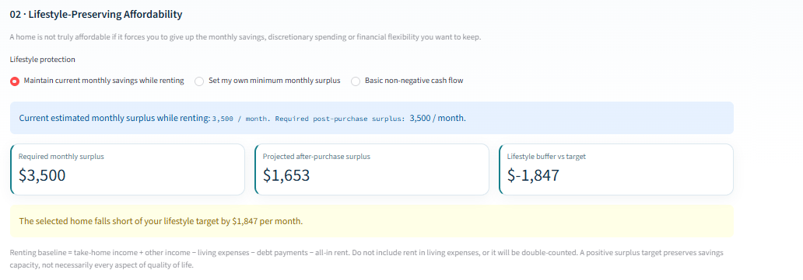
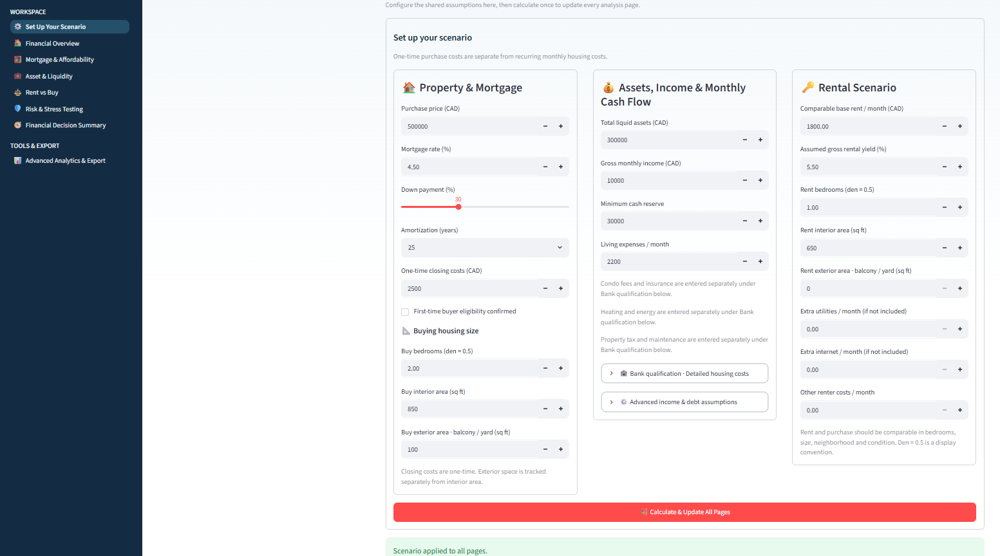
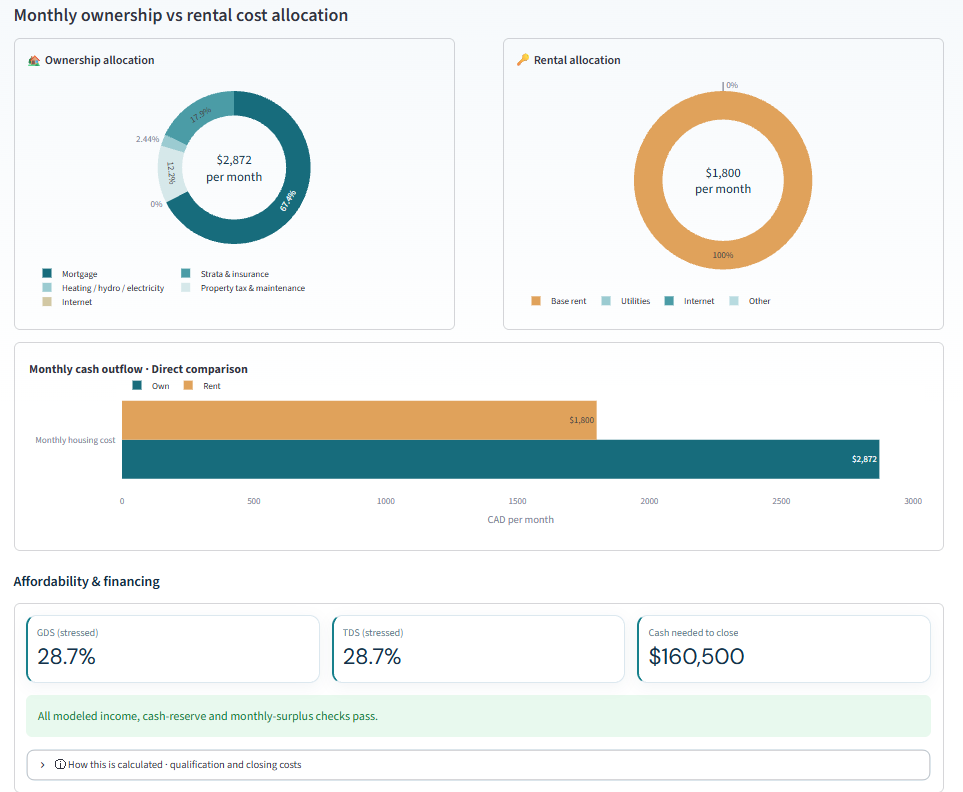
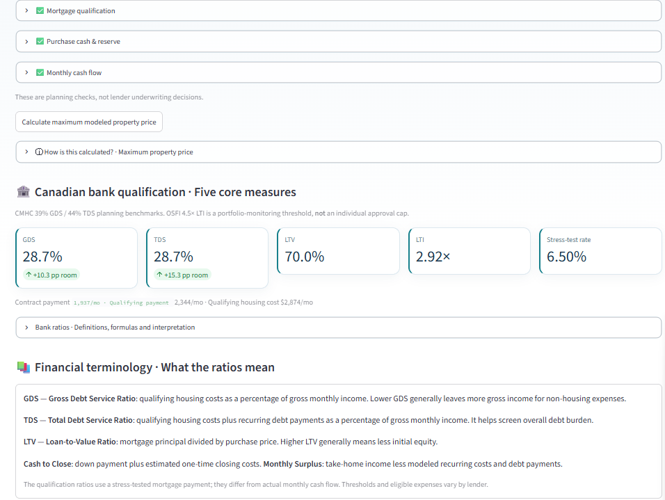
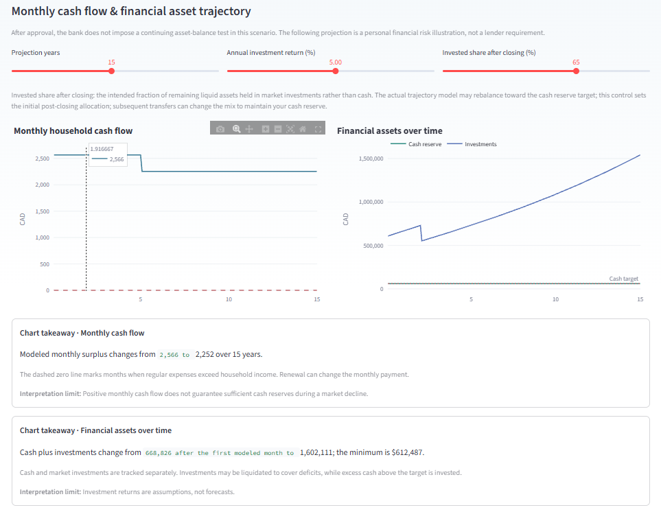
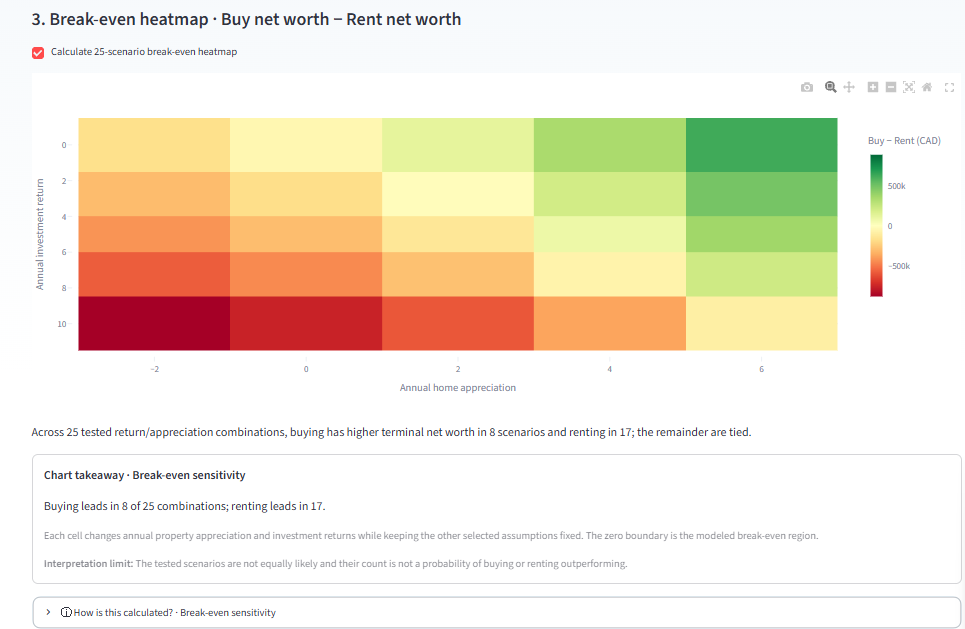
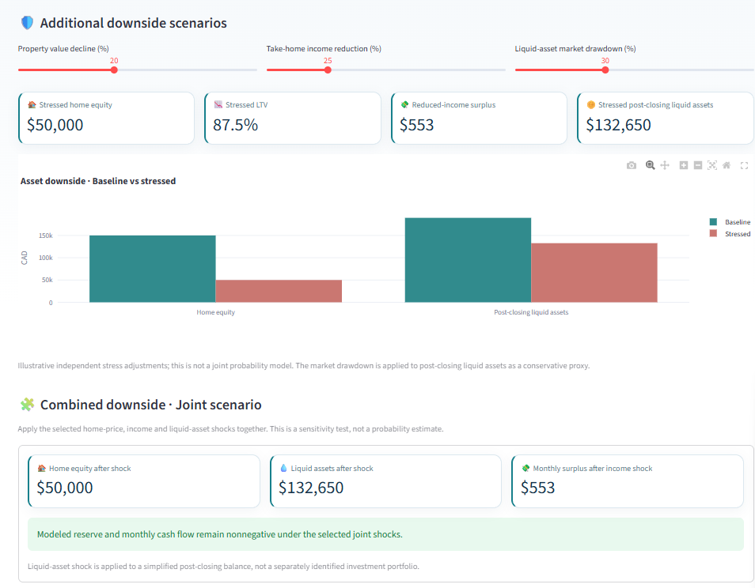
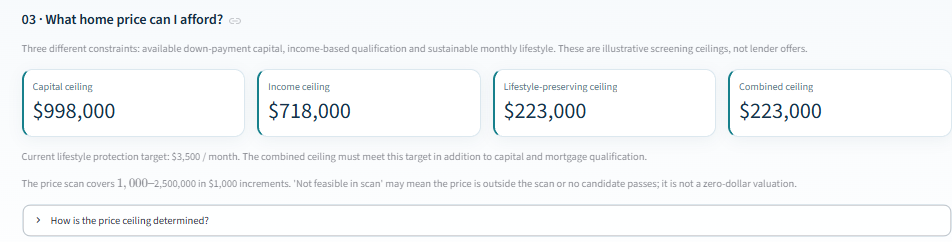
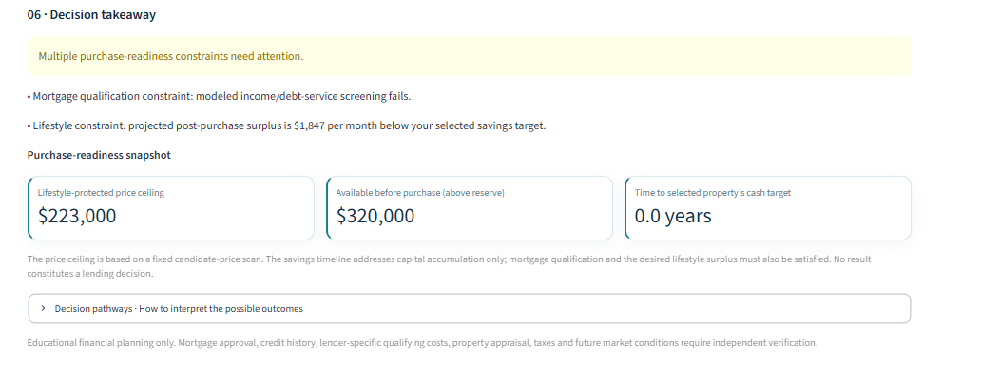

# Mortgage Financial Planner — Portfolio Case Study

*Copy-ready website narrative · English · v2.4.2*

## Project title
**Mortgage Financial Planner**

## Project subtitle
**A lifestyle-aware mortgage affordability and financial decision-support platform**

## Short card description (50–70 words)
An interactive financial planning application that evaluates Canadian mortgage qualification, housing affordability, rent-versus-buy outcomes, and post-purchase financial resilience. Built with Python, Streamlit, and Plotly, the platform integrates cash-flow modeling, reverse affordability analysis, dynamic purchase timelines, and stress testing. Its defining feature estimates how much home a household can afford **while preserving a chosen level of monthly savings**.

## Hero introduction
### Beyond mortgage approval: can you afford the life that comes with homeownership?

A mortgage qualification result answers whether a borrower may satisfy certain lending criteria. It does not fully answer whether the purchase leaves enough money for everyday living, savings, emergencies, and long-term financial goals.

I developed **Mortgage Financial Planner** to bridge that gap. The application integrates mortgage underwriting indicators with household cash flow, down-payment capital, liquidity reserves, investment opportunity costs, and future risk scenarios. Users can explore not only *whether* they can buy, but *what price range* supports their preferred financial lifestyle and *when* they might be ready to purchase.

## Project at a glance

| Dimension | Description |
|---|---|
| Project type | Independent applied financial analytics and decision-support application |
| Geographic focus | British Columbia, Canada |
| Technologies | Python, Streamlit, Pandas, Plotly, OpenPyXL, Pytest |
| Core methods | Deterministic financial modeling, constraint-based price search, scenario analysis, sensitivity analysis, cash-flow projections |
| Deliverables | Interactive eight-page application, Excel export, model documentation, automated tests |
| Primary users | Prospective homebuyers and users exploring the financial trade-offs of buying versus renting |
| My contribution | Financial model design, Python implementation, dashboard design, scenario workflows, visualization, validation, and documentation |

## 01 — The problem

Traditional affordability tools often emphasize mortgage payment estimates or lender qualification ratios. Those measures are useful, but they can overlook the relationship between housing costs and a household's ability to preserve savings, maintain emergency reserves, and withstand financial shocks.

The project was designed around three linked decisions: **Can I qualify? Can I sustainably afford it? Should I buy now or continue renting?**

## 02 — My approach

I built a shared scenario workspace in which users specify the property, financing terms, household income, liquid assets, monthly commitments, ownership expenses, and rental alternative. Those inputs feed independent but connected modules for mortgage qualification, affordability constraints, capital allocation, rent-versus-buy projections, and financial risk.

Rather than reducing affordability to a single number, the system presents **capital capacity**, **income-based qualification**, **monthly lifestyle capacity**, and **the combined feasible price ceiling**. The user can then examine what changes under different savings targets, market assumptions, and adverse events.

## 03 — Key analyses and visualizations

### A. Financial Overview — understand the cost structure

**Purpose:** Establish a common baseline for monthly ownership costs, rental outflow, and capital required at purchase.

**Variables:** Contract mortgage payment; strata fees; insurance; heating; property tax; maintenance; owner internet; rental base cost and additional expenses; down payment; closing costs; remaining liquid assets; reserve floor.

**Visualizations:** Ownership/rental allocation donuts, monthly outflow comparison bars, purchase capital allocation donut and bar chart, and financial-resilience indicator.

**What the charts reveal:** Which cost categories drive monthly housing outflow and how much liquidity remains after the purchase. The dashboard explicitly separates monthly cash outflow from economic net worth, because mortgage principal repayment contributes to home equity.

### B. Mortgage & Affordability — distinguish qualification from comfort

**Purpose:** Evaluate lender-style screening measures alongside actual monthly cash flow.

**Variables:** Gross annual income, estimated net income, debt payments, mortgage principal, amortization, contract and qualifying rates, property tax, heating and strata fees, closing costs and reserves.

**Metrics:** GDS, TDS, LTV, LTI, stress-test rate, qualifying mortgage payment, actual mortgage payment, post-closing cash and monthly surplus.

**What the metrics reveal:** A borrower may pass illustrative GDS/TDS checks but still face reduced savings capacity. These indicators support planning and do not constitute bank approval.

### C. Asset & Liquidity — assess financing capacity and reserve safety

**Purpose:** Examine the trade-off between funding a down payment, retaining investable assets, and preserving emergency cash.

**Variables:** Cash/deposits, market investments, eligible-asset recognition fraction, illustrative loan-to-asset ratio, asset-backed down payment, investment return, investment allocation, drawdown stress, and cash reserve target.

**Visualizations:** Capital-allocation donuts, financing-capacity bars, cash/investment trajectories, reserve diagnostics, and annual contribution/withdrawal bars.

**What the charts reveal:** Whether an illustrative asset-financing pathway leaves enough capital and how projected liquidity evolves. This module is not a lender-specific asset-backed mortgage offer.

### D. Rent vs Buy — evaluate long-term financial trade-offs

**Purpose:** Compare two financial pathways using modeled net worth rather than monthly payments alone.

**Variables:** Home price, down payment, mortgage pathway, property appreciation, rent growth, investment returns, selling costs, investment allocation, comparison horizon, and housing-size comparability.

**Visualizations:** Buy/rent terminal net-worth cards, home-equity and investment trajectories, crossover indicators, and a 25-combination break-even sensitivity heatmap.

**What the charts reveal:** How assumptions about property appreciation and financial-market returns can change the preferred outcome. Scenario counts are not probabilities, and different-sized homes should not be treated as directly comparable.

### E. Risk & Stress Testing — examine downside resilience

**Purpose:** Test the sensitivity of mortgage affordability and household liquidity to unfavorable conditions.

**Variables:** Renewal year/rate, unemployment duration and timing, special assessment amount/timing, property-price decline, take-home income reduction, investment drawdown, and property price/mortgage rate combinations.

**Visualizations:** Emergency cash trajectory, reserve threshold, 25-cell affordability heatmap, down-payment comparison table, stressed equity and asset bars, and combined-downside summary.

**What the charts reveal:** How financial buffers and projected surplus change when the baseline assumptions deteriorate. These are deterministic stress tests, not estimates of event likelihood.

### F. Financial Decision Summary — turn analytics into a decision

**Purpose:** Consolidate technical outputs into a structured purchase-readiness assessment.

**Six decision stages:** Mortgage qualification; lifestyle-preserving affordability; maximum feasible home price; time to save and dynamic purchase readiness; five-year post-purchase cash flow; conditional decision takeaway.

**Defining feature:** Users can protect their current estimated rent-era monthly savings, set a custom monthly surplus target, or use a basic nonnegative-cash-flow threshold. The model searches for the highest home price that meets that lifestyle target alongside capital and income constraints.

**Conditional decision pathways:** The final decision stage distinguishes a scenario that passes all modeled checks from lifestyle-only shortfalls, insufficient purchase capital, debt-service qualification failures, negative cash flow, and combinations of constraints. The application identifies which constraint is binding and suggests the category of adjustment to investigate, without presenting the result as lender approval or personal financial advice.

**Decision Takeaway illustration:** When the selected home does not preserve the user's target savings, the interface explicitly flags that shortfall even if other modeled checks pass. If mortgage qualification also fails, both issues appear rather than a misleading unconditional success message. The final screen reports the lifestyle-protected price ceiling, cash available above the reserve floor before purchase, and time to the selected property's cash target. A savings timeline does not imply loan approval.

*The final v2.4.2 Decision Takeaway screenshot is included below. The previous malformed version is retained only as historical QA evidence.*

## 04 — Illustrative scenario: why the lifestyle threshold matters

The screenshots use hypothetical values, including a **CAD 500,000** purchase price, **30% down payment**, **4.5% mortgage rate**, **CAD 300,000 liquid assets**, and **CAD 1,800 monthly rent**. In the captured scenario, the mortgage principal is **CAD 350,000**, with **CAD 2,428** estimated monthly post-purchase surplus and **CAD 3,500** estimated monthly savings while renting.

The earlier affordability scenario showed a **lifestyle gap of −CAD 1,072 per month**. A subsequent screenshot taken with different inputs shows a **CAD 1,847 monthly lifestyle shortfall** (CAD 3,500 target versus CAD 1,653 projected surplus). The earlier reverse affordability scan reports a **CAD 998,000 capital ceiling**, **CAD 718,000 income-screening ceiling**, and a **CAD 223,000 lifestyle-preserving ceiling**, making the combined ceiling **CAD 223,000** under those inputs.

**Interpretation:** Even when a proposed CAD 500,000 home passes baseline lender-style screening, it may fail the user's chosen savings-preservation objective. The result demonstrates why *maximum borrowable amount* and *sustainable personal affordability* should not be presented as interchangeable.

*These values are screenshot examples, not a verified real-world mortgage quotation. Price-ceiling estimates depend on model assumptions, including fixed ownership costs during the price scan.*

## 05 — Engineering and analytical decisions

**Shared scenario state:** A dedicated setup page applies consistent inputs across the analytical workspaces, reducing contradictory calculations between pages.

**Separation of financial concepts:** Qualifying mortgage payments are distinct from actual contractual payments. Capital adequacy, debt-service ratios, and post-purchase surplus are tested separately.

**Scenario-based, not probabilistic:** Deterministic projections and heatmaps are used to show assumption sensitivity. No claim is made that any particular scenario is likely to occur.

**Explainability:** Charts include interpretation notes, calculation disclosures, and caveats so that users can understand both the result and its limitations.

**Quality assurance:** Python unit and regression tests check mortgage calculations, affordability constraints, shared-page structure, and documentation integrity. Manual browser and external rule checks are additional release requirements.

## 06 — Skills demonstrated

**Financial analytics:** Mortgage amortization, cash-flow modeling, debt-service screening, purchase-capital allocation, net-worth comparison, reserve analysis.

**Data analytics and decision modeling:** Constraint-based search, deterministic forecasting, sensitivity heatmaps, scenario comparison, model diagnostics.

**Technical implementation:** Python application architecture, Streamlit session state, Plotly interactive charts, Pandas-based analytical outputs, Excel generation, automated tests.

**Communication:** Executive-level summaries, visual storytelling, explainable assumptions, financial terminology, and responsible interpretation of model uncertainty.

## 07 — Limitations and future improvements

This is a planning prototype rather than a lender-certified calculator. The model does not independently verify creditworthiness, tax liabilities, insurance eligibility, current government fee rules, market prices, or individual lender underwriting. Its lifestyle target preserves a modeled **monthly savings buffer**, not housing quality or subjective wellbeing. Housing-cost inputs may need adjustment when scanning substantially different property prices.

Potential extensions include a more detailed Canadian take-home pay calculator, scenario persistence, a comparable-property quality adjustment, live market-data integration, and probabilistic risk analysis.

## Portfolio footer — ready to paste

**Tools:** Python · Streamlit · Plotly · Pandas · OpenPyXL · Pytest  
**Methods:** Financial Modeling · Mortgage Qualification · Cash-Flow Analysis · Scenario Simulation · Sensitivity Analysis · Decision Support  
**Status:** Functional portfolio prototype · GitHub release candidate  
**Source code:** Add repository URL after publishing  
**Live application:** Add deployment URL after publishing

### Final Decision Takeaway interface (v2.4.2)

The final view separates the conditional conclusion, binding constraints, and three purchase-readiness metrics. Screenshot values are illustrative and may differ across scenarios.
